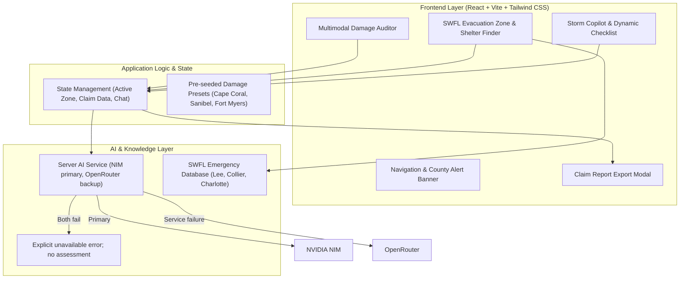

# Implementation Plan: SWFL StormGuard AI

> **Current status (November 2, 2026):** This document preserves the original design proposal. The implemented app and binding rules are in `AGENTS.md`, `docs/contracts.md`, and `README.md`. Where this plan conflicts with them, the implementation wins. In particular, the app does not use browser API keys, does not silently substitute samples, does not claim FEMA classifications or repair quotes, and does not infer evacuation zones from city names.

A hyper-local hurricane preparedness, evacuation intelligence, and multimodal AI damage assessment web application engineered for Southwest Florida (Lee, Collier, and Charlotte counties).

---

## 1. Goal Description

Southwest Florida experiences intense, recurring hurricane impacts (e.g., Ian, Milton, Helene). Residents, students, and local businesses face two critical bottlenecks during storm events:
1. **Evacuation & Life Safety Ambiguity**: Confusion surrounding localized storm-surge evacuation zones (A through E), open emergency shelter capacity (e.g., Alico Arena at FGCU, Hertz Arena in Estero), and rapidly changing boil-water notices.
2. **Post-Landfall Insurance & FEMA Delay**: Filing claims requires rigorous photographic categorization of damage (roof underlayment breaches, waterlines on drywall, structural framing defects). Delays or improper documentation postpone recovery aid by months.

**SWFL StormGuard AI** delivers an all-in-one, high-impact web application featuring:
* **Multimodal Property Damage & Loss Auditor**: Upload a photo of exterior/interior damage or inventory. Vision AI analyzes damage severity, FEMA damage category, detects safety hazards (mold, wiring, collapse risk), and produces an exportable, itemized insurance claim summary.
* **SWFL Evacuation & Zone Navigator**: Instant zone identification (Zones A–E) for Cape Coral, Fort Myers, Sanibel, Naples, Estero, and Punta Gorda, with real-time shelter statuses and supply distribution points.
* **Interactive AI Crisis Copilot & Dynamic Checklist**: Context-aware guidance for generator safety, shutter timing, and pet evacuation protocols.
* **Zero-Failure Offline Demo Engine**: Pre-bundled high-res damage test cases and pre-compiled telemetry ensuring the live 5-minute judge demo never fails, even under poor conference Wi-Fi.

---

## 1.1 Solo Builder & AI Development Team

The participant is **building solo**: one human entrant, project owner, and submission captain. **Codex, OpenCode, and Antigravity (`agy`) are the AI development tools supporting that participant**, not additional human teammates. List all AI tools used in the hackathon submission.

### AI Tool & Model Setup

| Tool | Assigned role | Model configuration |
|---|---|---|
| **Codex** | Lead coordinator and integrator: break down the plan, define shared interfaces, review changes, resolve integration issues, and run final checks. | **`gpt-6.1-sol-medium-fast`** (user-reported selection). |
| **OpenCode** | AI service and data implementation: multimodal request/response handling, response validation, sample cases, and explicit demo fallback behavior. | **DeepSeek V4.1 Flash**, free option in OpenCode, with **max effort** (interpreting the user's “max” setting). |
| **Antigravity (`agy`)** | Frontend and demo experience: React components, responsive layout, upload/preview interactions, printable reports, and browser verification. | **Gemini 3.8**, using **High Effort** (user-reported selection). |

Model names and settings above were supplied by the project owner. They document the intended setup; they have not been independently verified against active sessions or provider API IDs. Resolve each tool's exact CLI model identifier when launching automated tasks. These are the intended assignments, not a claim that an automated connection is already configured. Each tool uses its own authenticated session. Their chat histories are separate; context must be passed through instructions, task handoffs, and committed files.

### Coordination & File Ownership

1. **Agree on shared contracts first.** Codex establishes the scaffold, dependencies, data shapes, and service exports before parallel implementation. Record shared project instructions in root `AGENTS.md`, and explicitly ask every tool to read both `AGENTS.md` and `plan.md` when starting a task.
2. **Give each worker a separate Git worktree and branch.** Keep Codex in the integration checkout, OpenCode on `work/backend`, and Antigravity on `work/frontend`. Create worktrees after the initial project commit. A worker edits only its assigned checkout.
3. **Assign one owner per file.** Codex owns scaffold/configuration and shared contracts; OpenCode owns `src/services/` and `src/data/`; Antigravity owns `src/components/` and presentation styles. Route changes to dependencies, shared contracts, and integration files through Codex.
4. **Dispatch bounded tasks.** Each handoff states the task, allowed files, expected behavior, dependencies, and verification command. If a task requires another worker's files, report the dependency to Codex before editing them.
5. **Return reviewable results.** Each worker reports its branch, commit hash, changed files, checks run, and remaining issues. Codex reviews and merges completed work, then verifies the integrated application. Instructions and status in separate worktrees do not synchronize automatically; pass updated contracts and handoffs explicitly.
6. **Keep the solo participant informed.** Codex surfaces scope decisions and blockers to the project owner. The owner gives the pitch and submits the project; AI tools assist with implementation, review, and rehearsal.

### Application AI Model

**Current integration choice:** NVIDIA NIM primary with `nvidia/nemotron-3.5-super-vl-120b-a12b`, and OpenRouter backup with `nvidia/nemotron-3.5-super-vl:free`. Both routes accept image input and JSON-schema output. Set server-only `AI_PROVIDER=nim`, `AI_FALLBACK_PROVIDER=openrouter`, and the matching provider keys/models. Both providers were verified live on November 2, 2026, including a browser upload and a simulated-primary-failure failover. Because both routes use Nemotron, a shared underlying model outage can affect both.

The **runtime vision model is separate from the models powering the development tools**. Provider credentials and model IDs stay server-side; they are never exposed through a `VITE_` variable, browser storage, logs, or responses. Gemini runtime support and the earlier Gemini credential were removed. Development-tool subscriptions or logins do not configure application credentials.

If live analysis is unavailable, show an explicit **demo/sample result** label. Pre-computed results must not be presented as a fresh AI assessment of an arbitrary uploaded image.

---

## 2. User Review Required

**Implementation decisions (supersede conflicting proposals below):** Follow `AGENTS.md` and `docs/contracts.md`. NIM/OpenRouter credentials and model IDs stay server-side in `NIM_API_KEY`/`NIM_MODEL` and `OPENROUTER_API_KEY`/`OPENROUTER_MODEL`; no browser API-key drawer or `VITE_` credentials. Live failures show explicit errors, and samples require explicit user selection and labeling. Emergency data remains unavailable without verified sources and timestamps; no city-based evacuation zones or fabricated live shelter capacity. The MVP exports a provisional property documentation draft, with no official FEMA classification or repair quote. Frontend uses React 19, Vite 8, and Tailwind 4 as documented in `docs/dependencies.md`.

> [!IMPORTANT]
> **Demo Reliability & API Fallback**:
> Live analysis runs only when a server-side provider is configured. The primary is NIM and the backup is OpenRouter. Failover is limited to provider/service failures and never substitutes a sample. If both providers fail, the UI shows an explicit unavailable error and no assessment. Samples are always chosen deliberately by the user and are visibly labeled.

> [!NOTE]
> **Hackathon Submission Deadline**:
> Build freeze is strictly at **12:40 PM**. The repository will be pushed to a public GitHub repository and prepared for the form submission at `https://forms.cloud.microsoft/r/d17nVEJXvZ` before 12:40 PM.

---

## 3. Open Questions

1. **API Key Setup**: Resolved. NIM and OpenRouter keys are server-side in ignored `.env.local`; both were verified live on November 2, 2026. There is no interactive browser key drawer.
2. **Additional Features**: Would you like an interactive FEMA claim PDF/print export or is a downloadable JSON/formatted report sufficient? (We will implement a print-styled formal claim summary view).

---

## 4. System Architecture



---

## 5. Proposed Changes

> **Historical proposal:** The implemented app follows `AGENTS.md` and `docs/contracts.md`. Items below that mention repair estimates, FEMA classifications, webcam capture, live shelter capacity, or automatic sample fallback were not implemented and must not be presented as current behavior.

### Component 1: Core Scaffolding & Configuration

#### [NEW] `package.json`
* Lightweight React 19 / Vite stack with Tailwind CSS, Lucide Icons, and `@google/genai` (or native fetch client):
```json
{
  "name": "swfl-stormguard-ai",
  "private": true,
  "version": "1.0.0",
  "type": "module",
  "scripts": {
    "dev": "vite",
    "build": "vite build",
    "preview": "vite preview"
  },
  "dependencies": {
    "react": "^19.0.0",
    "react-dom": "^19.0.0",
    "lucide-react": "^1.16.0",
    "clsx": "^2.1.1",
    "tailwind-merge": "^3.0.0"
  },
  "devDependencies": {
    "@vitejs/plugin-react": "^4.3.4",
    "tailwindcss": "^4.0.0",
    "@tailwindcss/vite": "^4.0.0",
    "vite": "^6.2.0"
  }
}
```

#### [NEW] `vite.config.js`
* Configures Vite with React plugin and Tailwind CSS v4 support.

#### [NEW] `index.html`
* Root HTML document titled `SWFL StormGuard AI | Hurricane & Damage Intelligence`.

---

### Component 2: Local SWFL Knowledge & Pre-seeded Datasets

#### [NEW] `src/data/swflEmergencyData.js`
Contains accurate geo-data for Southwest Florida:
* **Counties**: Lee, Collier, Charlotte.
* **Municipalities**: Fort Myers, Cape Coral, Sanibel, Naples, Marco Island, Estero, Bonita Springs, Punta Gorda.
* **Evacuation Zones**: Zone A (barrier islands & storm surge < 10ft), Zone B (surge 10–15ft), Zone C (surge 15–20ft), Zone D (surge 20–25ft), Zone E.
* **Shelters with Live Capacity**:
  - *Alico Arena (FGCU Campus, Estero)* - General & Student population, Pet-friendly.
  - *Hertz Arena (Estero)* - General population & Special needs.
  - *Island Coast High School (Cape Coral)* - North Lee County hub.
  - *Golden Gate High School (Naples)* - Collier County hub.
* **Active Emergency Advisories**: Boil-water notices, sandbag distribution sites, and curfew notices.

#### [NEW] `src/data/sampleDamageCases.js`
Provides instant-load sample assets and benchmark AI evaluations for bulletproof live demos:
* **Preset 1 (Cape Coral Roof)**: Tile displacement, underlayment puncture, estimated repair: $4,500 – $7,200.
* **Preset 2 (Fort Myers Beach Waterline)**: 24-inch drywall flood watermark, silt intrusion, mold hazard, estimated repair: $12,000 – $18,500.
* **Preset 3 (Sanibel Lanai Screen)**: High-wind framing separation, debris impact, estimated repair: $1,800 – $3,200.

---

### Component 3: AI Engine & Multimodal Processing

#### [NEW] `src/services/aiService.js`
* **Multimodal Vision Handler**:
  - Ingests one validated JPEG/PNG/WebP upload, up to 5 MiB.
  - Sends the image to the server-owned provider chain: NIM primary, OpenRouter backup.
  - Enforces strict JSON-schema output and validates the result before adding trusted provenance.
  - On provider or network failure, shows an explicit unavailable error and no assessment. Samples are never substituted automatically.

* **Emergency Copilot Handler**:
  - Handles real-time hurricane preparedness and post-storm guidance queries referencing SWFL county regulations.

---

### Component 4: User Interface & Experience

#### [NEW] `src/components/Header.jsx`
* Top navigation bar with live SWFL alert ticker and settings trigger.

#### [NEW] `src/components/DamageAuditor.jsx`
* The "Hero Feature" for hackathon judging:
  - Drag-and-drop file upload with preview.
  - One-click sample test buttons (*"Cape Coral Roof"*, *"Fort Myers Beach Flood"*, *"Sanibel Lanai"*).
  - Animated scanning overlay effect indicating AI analysis.
  - Diagnostics card: Severity badge, cost estimation, FEMA classification, and safety warnings.
  - *"Generate Formal Insurance Claim"* button.

#### [NEW] `src/components/EvacuationZoneFinder.jsx`
* Interactive address and municipality search with surge chart and shelter capacities.

#### [NEW] `src/components/StormCopilot.jsx`
* AI conversational assistant with quick-prompt chips and dynamic countdown checklist.

#### [NEW] `src/components/ClaimReportModal.jsx`
* Clean, printable insurance report view.

---

## 6. Verification Plan

### Automated Tests & Quality Checks
* **Scaffolding and Build Validation**:
  ```bash
  npm run build
  ```
  Must compile without errors or warnings.
* **Service Unit Verification**:
  - Run a lightweight node script to verify that `aiService.js` correctly parses image payloads and returns valid JSON.

### Manual Verification ("The 5-Minute Pitch Rehearsal")
1. **Introduction (1 min)**: Problem statement (SWFL hurricanes, insurance claim delays, evacuation confusion).
2. **Hero Feature Demo - Multimodal Damage Auditor (2 min)**: Select a labeled sample or upload a photo -> show provisional observations, hazards, limitations, provenance, and the printable documentation draft. Do not claim a FEMA classification or repair quote.
3. **County Resources & Checklist (1 min)**: Show sourced county emergency-management links and the static preparedness checklist. Do not fabricate live evacuation orders or shelter capacity.
4. **Storm Copilot (30 sec)**: Show the explicitly unavailable copilot state and the static checklist.
5. **Impact & Q&A (30 sec)**: Review the NIM/OpenRouter architecture, live-verified latency, and the honest scope limits.


## Current provider decision (supersedes earlier runtime proposals)

NVIDIA NIM primary (`nvidia/nemotron-3.5-super-vl-120b-a12b`) with OpenRouter backup (`nvidia/nemotron-3.5-super-vl:free`). Separate server-only keys, explicit provider ordering and bounded live failover; no automatic sample substitution. Gemini application integration and saved key were removed. Development-tool assignments above remain separate. See `server/README.md` and `docs/contracts.md`. Both providers were verified live on November 2, 2026, including a browser upload and simulated-primary-failure failover. Real damaged-property photo accuracy remains unevaluated.
